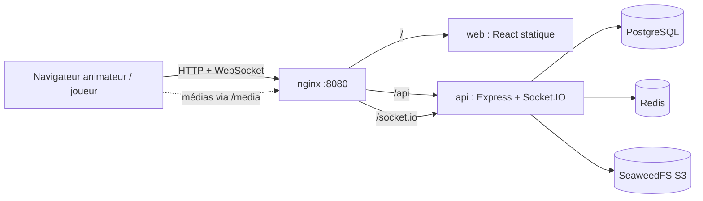
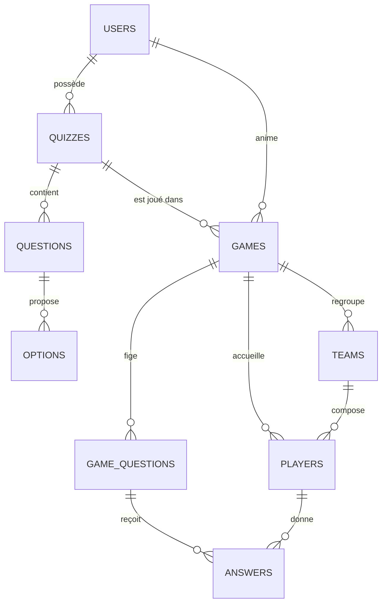
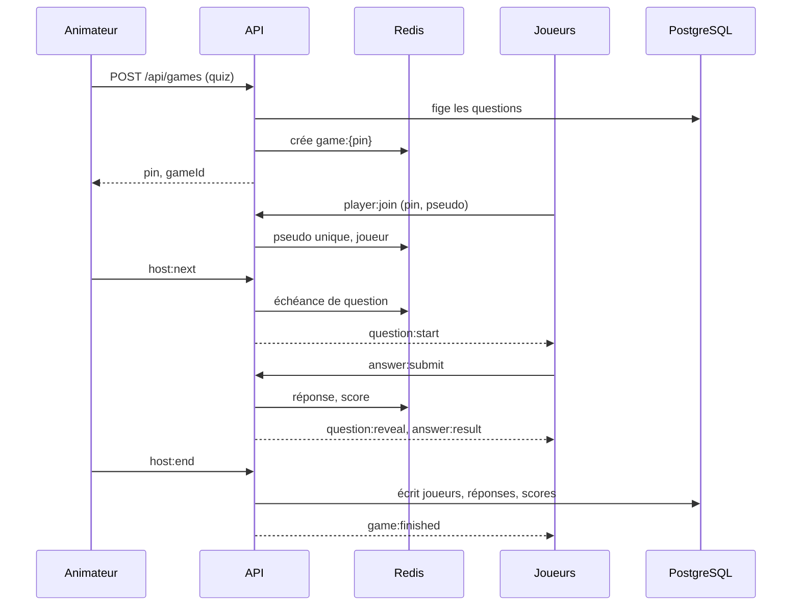

# Architecture

## Vue d'ensemble



Le déploiement est défini dans [docker-compose.yml](../docker-compose.yml).

| Service | Image | Rôle | Réseaux | Exposé |
| --- | --- | --- | --- | --- |
| `proxy` | `nginx:1.29-alpine` | Point d'entrée unique, routage, upgrade WebSocket | `frontend` | `HTTP_PORT` (8080) |
| `web` | build `./web` | Fichiers statiques du front React | `frontend` | interne :80 |
| `api` | build `./api` | API REST, Socket.IO, logique de jeu | `frontend`, `backend` | interne :3000 |
| `db` | `postgres:18-alpine` | Données durables | `backend` | non |
| `redis` | `redis:8-alpine` | État des parties, pub/sub, limitation de débit | `backend` | non |
| `storage` | SeaweedFS (S3) | Images et médias des questions | `backend` | non |

Seul `proxy` est publié sur l'hôte. La base, Redis et le stockage ne sont joignables que depuis le réseau `backend`.

## Routage nginx

| Chemin | Destination | Remarque |
| --- | --- | --- |
| `/` | `web:80` | Repli sur `index.html` pour le routage côté client |
| `/api/` | `api:3000` | REST |
| `/socket.io/` | `api:3000` | En-têtes `Upgrade` et `Connection`, délais de lecture longs |
| `/media/` | `api:3000` | L'API vérifie les droits puis redirige vers une URL signée ou relaie le flux S3 |

## Composants de l'API

```
api/src
  config/        variables d'environnement validées au démarrage
  http/          routes REST, middlewares (auth, rate limit, validation, erreurs)
  realtime/      serveur Socket.IO, authentification des sockets, gestionnaires d'événements
  game/          machine à états, chronomètre, score, classement (logique pure, testable)
  repositories/  accès PostgreSQL, Redis, S3
  services/      comptes, quiz, parties, rapports, médias
```

Règles de dépendance : `http` et `realtime` appellent `services` ; `services` appellent `game` et `repositories` ; `game` ne dépend d'aucune infrastructure.

## Front

```
web/src
  pages/        connexion, tableau de bord, studio, salle d'attente, partie, rapports, rejoindre
  features/     auth, quiz-editor, host, player, reports
  realtime/     client Socket.IO, synchronisation d'horloge, reconnexion
  api/          client REST typé
```

L'écran animateur et l'écran joueur partagent le même client temps réel. L'état de la partie côté client est dérivé des événements ; le client ne calcule jamais le score ni la justesse.

### Studio de quiz

Les pages protégées (`/` et `/quizzes/:id`) partagent la mise en page `AppLayout` (en-tête, navigation, déconnexion).

- `/` : tableau de bord. Liste des quiz de l'utilisateur, création par un titre, suppression avec confirmation (refusée par l'API si le quiz a déjà des parties).
- `/quizzes/:id` : studio. Titre et description du quiz, liste des questions (sélection, monter, descendre, supprimer) et éditeur de question pour les quatre types (`single`, `multiple`, `true_false`, `text`).

`features/quiz-editor/questions.ts` contient les limites par type et la validation du formulaire, qui reprennent les règles de l'API (voir « API des quiz ») pour afficher les erreurs avant l'envoi. L'API reste la référence : toute écriture y est revalidée. Changer le type d'une question adapte les réponses déjà saisies (une seule bonne réponse pour `single`, toutes correctes pour `text`) ; quitter `true_false` repart de réponses vides. L'ajout d'images dans le studio dépend de l'envoi des médias (issue 1.5).

## Authentification

- Animateurs : inscription et connexion par email et mot de passe haché avec argon2. L'API émet un JWT signé avec `JWT_SECRET`, stocké dans un cookie `HttpOnly`, `Secure`, `SameSite=Lax`.
- Routes protégées : un middleware vérifie le JWT et rattache l'utilisateur à la requête. Les sockets animateur sont authentifiées avec le même jeton.
- Joueurs : aucun compte. Un `playerToken` signé est délivré à l'arrivée dans une partie et sert à la reconnexion.
- Rate limiting : compteurs Redis par IP sur l'authentification (10 requêtes par minute sur `/api/auth/login` et `/api/auth/register`, réponse `429` avec `Retry-After`). L'API ne fait confiance qu'à un proxy (`trust proxy` à 1) : l'IP est celle ajoutée par nginx, pas celle d'un en-tête `X-Forwarded-For` fourni par le client.
- Endpoints : `POST /api/auth/register`, `POST /api/auth/login`, `POST /api/auth/logout`, `GET /api/auth/me`. Mot de passe de 8 à 128 caractères ; `login` renvoie la même erreur pour un e-mail inconnu et un mauvais mot de passe. Le cookie est `Secure` quand `PUBLIC_URL` commence par `https://`.

## API des quiz

Toutes les routes exigent un animateur connecté. Un quiz n'est visible et modifiable que par son propriétaire : l'accès au quiz d'un autre utilisateur renvoie `404`, comme un quiz inexistant.

| Méthode | Chemin | Rôle |
| --- | --- | --- |
| `GET` | `/api/quizzes` | Liste des quiz de l'utilisateur avec le nombre de questions, du plus récemment modifié au plus ancien |
| `POST` | `/api/quizzes` | Crée un quiz (`title`, `description` facultative) |
| `GET` | `/api/quizzes/:id` | Quiz avec ses questions et leurs réponses, dans l'ordre |
| `PATCH` | `/api/quizzes/:id` | Modifie `title` et ou `description` |
| `DELETE` | `/api/quizzes/:id` | Supprime le quiz et ses questions ; `409 quiz_has_games` s'il a déjà des parties |
| `POST` | `/api/quizzes/:id/questions` | Ajoute une question à la fin |
| `PUT` | `/api/quizzes/:id/questions/:questionId` | Remplace une question et ses réponses |
| `DELETE` | `/api/quizzes/:id/questions/:questionId` | Supprime une question et renumérote les suivantes |
| `PUT` | `/api/quizzes/:id/questions/order` | Réordonne : `questionIds` doit contenir toutes les questions du quiz, une fois chacune |

Règles de validation d'une question (`400 invalid_input` avec le détail par champ) :

| Type | Réponses | Bonnes réponses |
| --- | --- | --- |
| `single` | 2 à 6 | exactement 1 |
| `multiple` | 2 à 6 | au moins 1 |
| `true_false` | exactement 2 | exactement 1 |
| `text` | 1 à 10 réponses acceptées | toutes |


## Données durables : PostgreSQL



| Table | Colonnes principales |
| --- | --- |
| `users` | `id` uuid, `email` unique, `password_hash`, `display_name`, `created_at` |
| `quizzes` | `id`, `owner_id` vers `users`, `title`, `description`, `created_at`, `updated_at` |
| `questions` | `id`, `quiz_id`, `position`, `type` (`single`, `multiple`, `true_false`, `text`), `text`, `media_key`, `duration_s`, `points`, `settings` jsonb |
| `options` | `id`, `question_id`, `position`, `text`, `media_key`, `is_correct` |
| `games` | `id`, `quiz_id`, `host_id`, `pin`, `mode` (`classic`, `team`, `homework`), `status` (`lobby`, `running`, `finished`), `started_at`, `finished_at` |
| `game_questions` | `id`, `game_id`, `position`, `question_snapshot` jsonb : copie figée de la question et de ses options au lancement |
| `teams` | `id`, `game_id`, `name` |
| `players` | `id`, `game_id`, `team_id` nullable, `nickname`, `final_score`, `final_rank`, `joined_at`, contrainte unique (`game_id`, `lower(nickname)`) |
| `answers` | `id`, `game_question_id`, `player_id`, `choice` jsonb, `is_correct`, `response_ms`, `points`, `streak`, unique (`game_question_id`, `player_id`) |

Choix de conception :

- `game_questions.question_snapshot` fige le contenu : modifier un quiz après coup ne change ni l'historique ni les rapports.
- La contrainte unique sur `answers` garantit une seule réponse par joueur et par question, même avec plusieurs instances.
- Les parties et réponses sont écrites en base à la fin de la partie ; pendant la partie, elles vivent dans Redis.
- Index : `games(host_id, finished_at desc)`, `answers(player_id)`, `players(game_id)`.
- Les suppressions de quiz utilisent `on delete restrict` si des parties existent, pour préserver l'historique.
- Le PIN est unique parmi les parties non terminées (index unique partiel sur `games(pin)`) et vérifié par `^[0-9]{6}$`.
- Les unicités de position (`questions`, `options`) sont différées pour permettre de réordonner dans une transaction.

### Migrations

Les migrations sont des fichiers SQL numérotés dans `api/migrations/` (`001_schema.sql`). Au démarrage, l'API applique celles qui manquent dans une transaction, sous un verrou consultatif PostgreSQL, ce qui reste sûr avec `--scale api=2`. L'historique est dans la table `schema_migrations`. `npm run migrate` dans `api/` les applique à la demande. Pour changer le schéma, ajouter un nouveau fichier ; ne jamais modifier un fichier déjà appliqué.

## État temps réel : Redis

| Clé | Type | Contenu | Durée de vie |
| --- | --- | --- | --- |
| `game:{pin}` | hash | état, index de question, `hostId`, `gameId`, mode | 24 h après dernière activité |
| `game:{pin}:players` | hash | `playerId` vers JSON (pseudo, jeton haché, connecté) | idem |
| `game:{pin}:nicknames` | set | pseudos en minuscules, garantit l'unicité | idem |
| `game:{pin}:q:{index}:answers` | hash | `playerId` vers réponse, temps, points | idem |
| `game:{pin}:scores` | sorted set | score par joueur, source du classement | idem |
| `game:{pin}:timer` | string avec expiration | échéance de la question, verrou `SET NX` de clôture | durée de la question |
| `pin:{pin}` | string | `gameId`, garantit l'unicité du PIN | idem |
| `rl:{route}:{ip}` | compteur | limitation de débit | fenêtre fixe de 60 s |

Le canal pub/sub de l'adaptateur Socket.IO relaie les diffusions entre instances de l'API.

## API sans état

Aucune donnée de partie ou de session n'est gardée en mémoire dans un processus : tout passe par Redis et PostgreSQL. Une instance peut donc être arrêtée ou dupliquée (`docker compose up --scale api=2`). Conséquence pour le temps réel : le transport `websocket` est forcé côté client, ce qui évite l'affinage de session sur nginx. Le proxy doit résoudre le service `api` par DNS Docker pour répartir les connexions.

## Flux principal d'une partie



